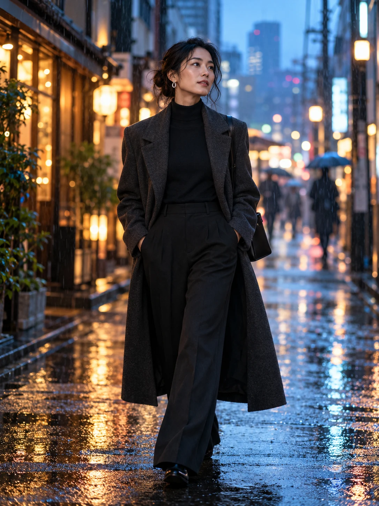
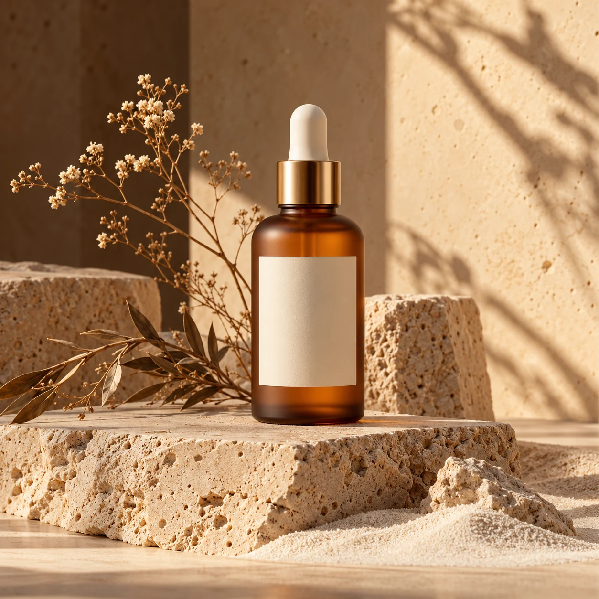
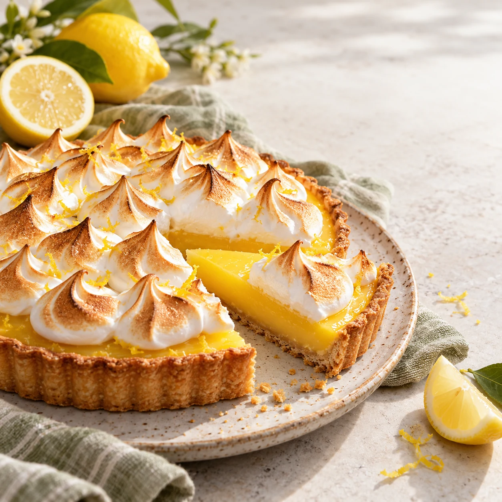
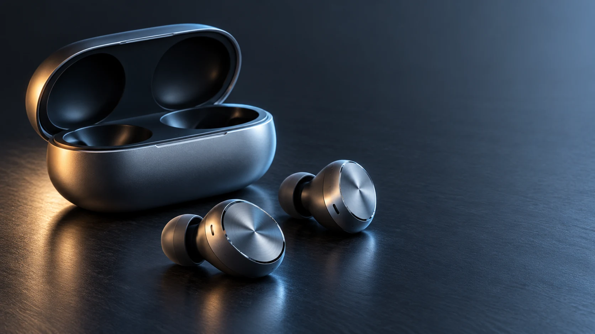
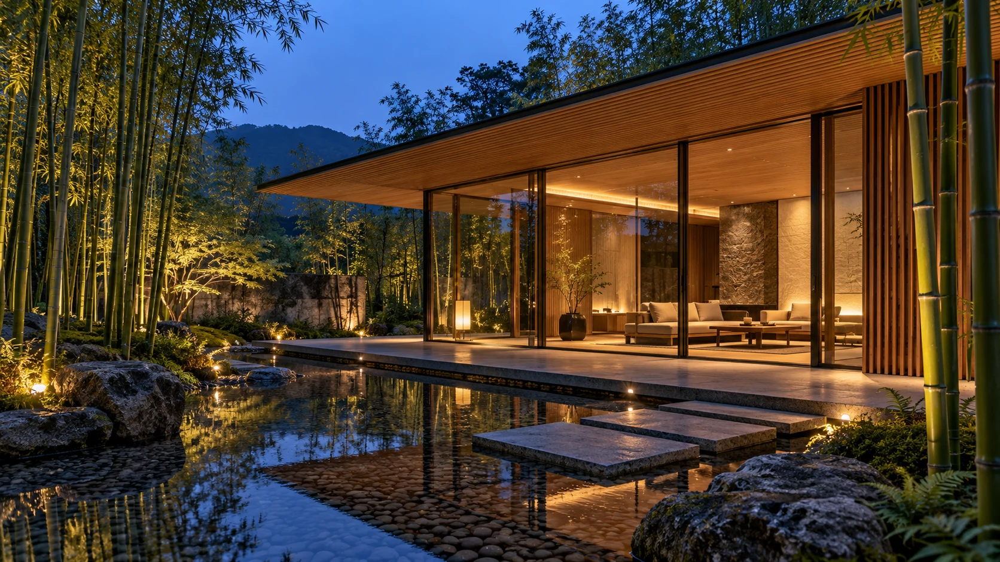
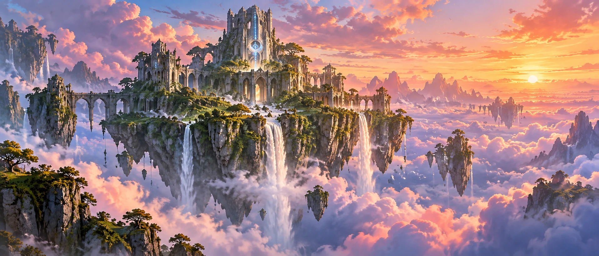
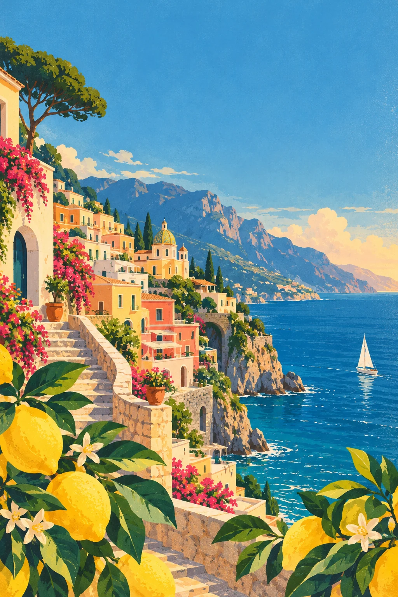
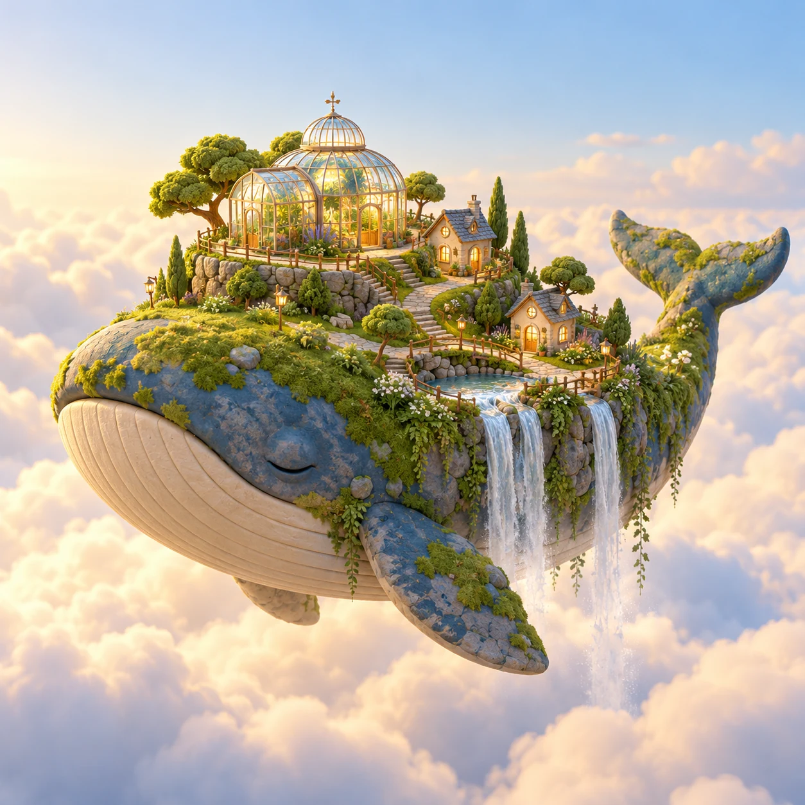
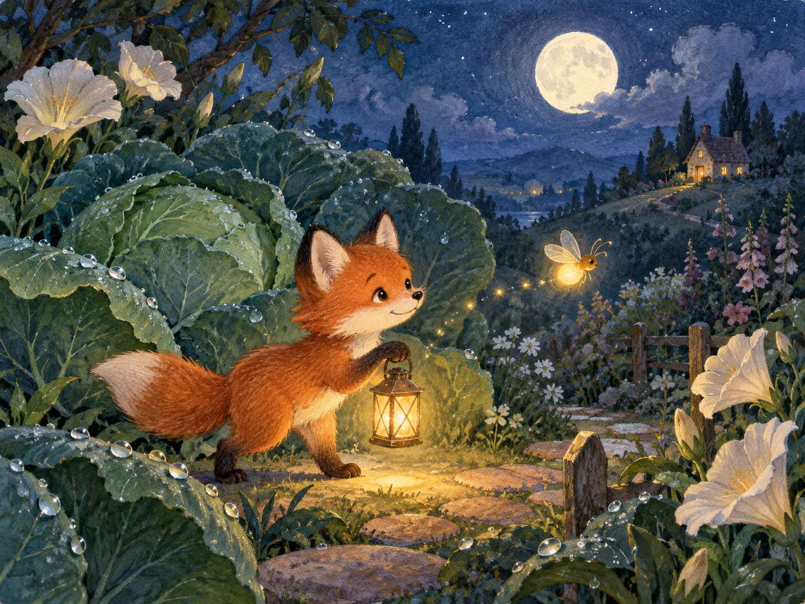

# 🎨 Vistella Prompt Recipes & Visual Engineering Guide

This collection contains curated, copyable starting points for visual generation on [Vistella (vistella.xyz)](https://www.vistella.xyz?utm_source=github&utm_medium=prompts_guide). See the [visual gallery](README.md) for reference images. Those images were made separately with imagegen and are not Vistella Playground results.

---

## 📐 The Universal High-Conversion Prompt Structure

To achieve predictable quality from state-of-the-art visual models:

$$\text{Output} = \text{Subject} + \text{Environment/Scene} + \text{Lighting/Mood} + \text{Camera/Optics} + \text{Color Grading} + \text{Style Details}$$

---

## 🌟 Category 1: Editorial & Portrait Photography

### 1.1 Scandinavian Minimalist Portrait
- **Visual Style:** Natural Portrait Studio
- **Recommended Aspect Ratio:** `3:4` or `4:5`
```text
Medium close-up portrait of a 28-year-old Danish woman with freckles, wearing an oversized beige wool knit sweater. Standing by a tall loft window during an overcast morning. Soft diffused natural light, muted earth tones, 50mm f/1.4 lens bokeh, authentic skin texture with microscopic pores, filmic aesthetic, 8k resolution.
```
👉 [Try on Vistella Playground](https://www.vistella.xyz/en/playground?utm_source=github&utm_medium=recipe_portrait_1)

### 1.2 Neon Street Portrait
- **Visual Style:** Cinematic Night Scene
- **Recommended Aspect Ratio:** `16:9`
```text
Cinematic nighttime portrait of an East Asian male streetwear designer standing in Shinjuku rain. Wet glossy reflections, vibrant magenta and cyan neon backlight, shallow depth of field, mist hanging in ambient light. Shot on Sony A7R V with 85mm f/1.2 G Master lens, cinematic color grading.
```
👉 [Try on Vistella Playground](https://www.vistella.xyz/en/playground?utm_source=github&utm_medium=recipe_portrait_2)

### 1.3 Architect at Work

- **Visual Style:** Editorial architectural portrait
- **Recommended Aspect Ratio:** `3:4`

```text
An East Asian female architect working at a drafting table in an ultra-modern concrete studio. Medium portrait with natural expression, simple neutral clothing and architectural models in the background. Soft morning sidelight through a tall window, faint dust motes, authentic skin texture, straight architectural lines, restrained neutral color grade and subtle film grain. No logos or readable text.
```


*Reference image made for this repository with imagegen; your result will vary.*

👉 [Try on Vistella Playground](https://www.vistella.xyz/en/playground?utm_source=github&utm_medium=prompt_recipe&utm_campaign=visual_recipes&utm_content=architect)

### 1.4 Rainy Tokyo Fashion Editorial

- **Visual Style:** Contemporary street-fashion photography
- **Recommended Aspect Ratio:** `3:4`

```text
A confident adult East Asian fashion designer walking through a rainy Tokyo side street at blue hour. Rain-dark pavement, softly defocused shop lights without readable signs, one adult in a tailored charcoal coat with simple silver earrings, natural skin texture and a candid expression. Medium full portrait at eye level, 50mm editorial street photography, cyan and warm amber reflections, soft mist and realistic rain. High-end contemporary fashion editorial photograph. No logos, readable text, watermark or resemblance to a known person.
```



*Reference image made for this repository with imagegen; your result will vary.*

👉 [Try on Vistella Playground](https://www.vistella.xyz/en/playground?utm_source=github&utm_medium=prompt_recipe&utm_campaign=visual_recipes&utm_content=rainy_fashion)

---

## 🏺 Category 2: Commercial & Product Visualization

### 2.1 Organic Skincare Cosmetic Shot
- **Visual Style:** Luxury Commercial Still Life
- **Recommended Aspect Ratio:** `1:1`
```text
A frosted amber glass skincare bottle placed on a sculpted travertine stone slab, surrounded by dried botanical twigs and fine white sand. Soft warm morning sunlight casting gentle elongated shadows. High-end magazine commercial photography, crisp focus, clean negative space, studio perfection.
```


*Reference image made for this repository with imagegen; your result will vary.*

👉 [Try on Vistella Playground](https://www.vistella.xyz/en/playground?utm_source=github&utm_medium=prompt_recipe&utm_campaign=visual_recipes&utm_content=skincare)

### 2.2 Modern High-Tech Acoustics
- **Visual Style:** Exploded 3D Industrial Design
- **Recommended Aspect Ratio:** `16:9`
```text
Floating matte black wireless over-ear headphones, exploded acoustic engineering visual with subtle golden internal components, dark slate background, volumetric rim lighting, crisp raytraced carbon fiber textures, KeyShot render, 8k detail.
```
👉 [Try on Vistella Playground](https://www.vistella.xyz/en/playground?utm_source=github&utm_medium=recipe_product_2)

### 2.3 Lemon Tart Bakery Campaign

- **Visual Style:** Bright editorial food photography
- **Recommended Aspect Ratio:** `1:1`

```text
An appetizing artisanal lemon tart with delicate toasted meringue peaks on a handmade ceramic plate, sliced lemon and a linen napkin on a pale stone counter. Close three-quarter tabletop shot; tart fills the frame with one clean area in the upper right for later layout. Tactile pastry detail, bright soft window light, fresh summer morning, lemon yellow, cream and restrained sage. Premium editorial food photography with realistic crumbs and glaze. No text, logo, packaging, watermark or hands.
```



*Reference image made for this repository with imagegen; your result will vary.*

👉 [Try on Vistella Playground](https://www.vistella.xyz/en/playground?utm_source=github&utm_medium=prompt_recipe&utm_campaign=visual_recipes&utm_content=lemon_tart)

### 2.4 Wireless Earbuds Product Launch

- **Visual Style:** Premium industrial-design product render
- **Recommended Aspect Ratio:** `16:9`

```text
A premium concept product photograph of compact wireless earbuds and their pebble-shaped charging case. Dark graphite studio surface with subtle brushed aluminum accents and one soft reflection. Three-quarter product view; earbuds and open case are separated enough to read clearly, with crisp silhouette and negative space to the right for later campaign copy. Photorealistic industrial-design render with precise manufacturing details. Sculpted cool rim light plus a small warm highlight, deep but readable shadows; graphite, silver and muted ice blue. No brand, logo, text, watermark or extra products; believable proportions.
```



*Reference image made for this repository with imagegen; your result will vary.*

👉 [Try on Vistella Playground](https://www.vistella.xyz/en/playground?utm_source=github&utm_medium=prompt_recipe&utm_campaign=visual_recipes&utm_content=earbuds)

---

## 🏛️ Category 3: Architecture & Interior Design

### 3.1 Japanese Modern Zen Pavilion
- **Visual Style:** Architectural Spatial Concept
- **Recommended Aspect Ratio:** `16:9`
```text
Modern Japanese architecture pavilion nestled in a tranquil bamboo grove. Slatted cedar wood exterior, floor-to-ceiling glass doors opening onto an illuminated pebble water terrace, twilight ambiance, soft golden interior warmth, architectural digest cover photography.
```


*Reference image made for this repository with imagegen; your result will vary.*

👉 [Try on Vistella Playground](https://www.vistella.xyz/en/playground?utm_source=github&utm_medium=prompt_recipe&utm_campaign=visual_recipes&utm_content=pavilion)

---

## 🖌️ Category 4: Digital Art & Fantasy Concepts

### 4.1 Ethereal Floating Citadel
- **Visual Style:** Fantasy Anime Concept Art
- **Recommended Aspect Ratio:** `21:9`
```text
A massive floating moss-covered ancient castle ruin hovering among drifting pastel clouds at sunset. Waterfalls cascading into empty sky, distant flocks of migrating white birds, glowing mystical runes etched into stone, Makoto Shinkai anime aesthetic, lush vibrant color palette, epic fantasy concept art.
```


*Reference image made for this repository with imagegen; your result will vary.*

👉 [Try on Vistella Playground](https://www.vistella.xyz/en/playground?utm_source=github&utm_medium=prompt_recipe&utm_campaign=visual_recipes&utm_content=citadel)

## 🧳 Category 5: Travel & Campaign Illustration

### 5.1 Amalfi Coast Vintage Travel Poster

- **Visual Style:** Mid-century screen-printed gouache illustration
- **Recommended Aspect Ratio:** `2:3`

```text
A mid-century travel-poster illustration of a coastal village on the Amalfi coast at late afternoon. Stacked pastel houses along a cliff, a winding stair, deep-blue sea and one small sailboat, lemon branches framing the lower edge. Bold simplified shapes, clear horizon and large open sky at the top reserved for a title added later. Vintage screen-printed gouache, subtle paper grain, limited palette of coral, lemon, teal, cream and navy. Warm sunny holiday feeling. No text, lettering, logos or watermark.
```



*Reference image made for this repository with imagegen; your result will vary.*

👉 [Try on Vistella Playground](https://www.vistella.xyz/en/playground?utm_source=github&utm_medium=prompt_recipe&utm_campaign=visual_recipes&utm_content=amalfi_poster)

## 🧸 Category 6: Stylized 3D & Game Art

### 6.1 Whale Island Miniature

- **Visual Style:** Tactile clay-and-paper 3D diorama
- **Recommended Aspect Ratio:** `1:1`

```text
A tiny floating island shaped like a sleeping whale, carrying a miniature greenhouse village above a sea of clouds. Include a glass conservatory, winding path, miniature trees, waterfalls from the island edge and small warm windows. Isometric three-quarter view, one centered diorama with generous clean background space. Polished tactile clay and paper miniature 3D render, rounded shapes and handmade material character. Soft studio sunlight with gentle shadows; powder blue, cream, moss green and warm amber. No text, logo, watermark or extra islands; keep miniature scale coherent.
```



*Reference image made for this repository with imagegen; your result will vary.*

👉 [Try on Vistella Playground](https://www.vistella.xyz/en/playground?utm_source=github&utm_medium=prompt_recipe&utm_campaign=visual_recipes&utm_content=whale_diorama)

## 📚 Category 7: Children's Book Illustration

### 7.1 Fox and Firefly

- **Visual Style:** Watercolor and colored-pencil picture-book scene
- **Recommended Aspect Ratio:** `4:3`

```text
A small red fox carrying a lantern through a moonlit garden to help a lost firefly find its way home. Oversized cabbage leaves, night-blooming flowers, dew and a tiny cottage far away. Gentle storybook scene with clear foreground, middle ground and background; fox and one glowing firefly are easy to read. Original hand-painted watercolor and colored pencil with soft paper texture and friendly rounded forms. Deep indigo evening, warm lantern glow, calm reassuring mood; midnight blue, sage green, muted orange and cream. Child-friendly, no frightening elements, text, logo, watermark or recognizable existing characters.
```



*Reference image made for this repository with imagegen; your result will vary.*

👉 [Try on Vistella Playground](https://www.vistella.xyz/en/playground?utm_source=github&utm_medium=prompt_recipe&utm_campaign=visual_recipes&utm_content=fox_storybook)

---

## 💡 Quick Tips for Vistella Creators

1. **Natural Descriptions Win**: Modern visual models on Vistella understand natural descriptive sentences much better than comma-separated tag dumps (e.g. `trending on artstation, masterpiece, best quality`).
2. **Specify Lighting First**: Defining the light source (e.g., *"golden hour sidelight"*, *"diffused cloudy sky"*, *"volumetric blue rim light"*) dramatically enhances realism and depth.
3. **Use Vistella Free Credits**: Every registered user on [vistella.xyz](https://www.vistella.xyz?utm_source=github&utm_medium=prompts_footer) gets free daily generation credits to test and iterate on prompts.
